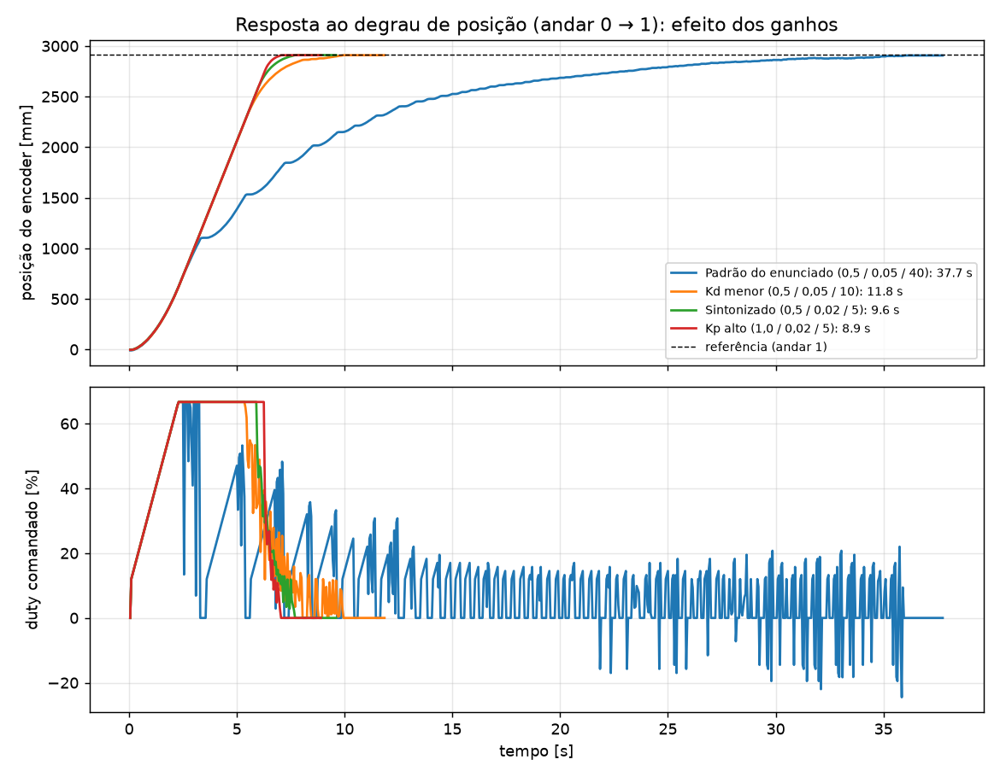
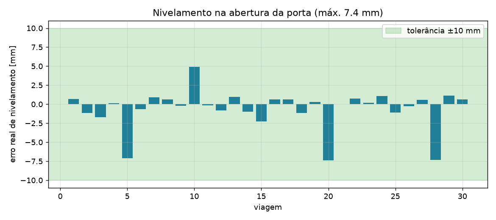
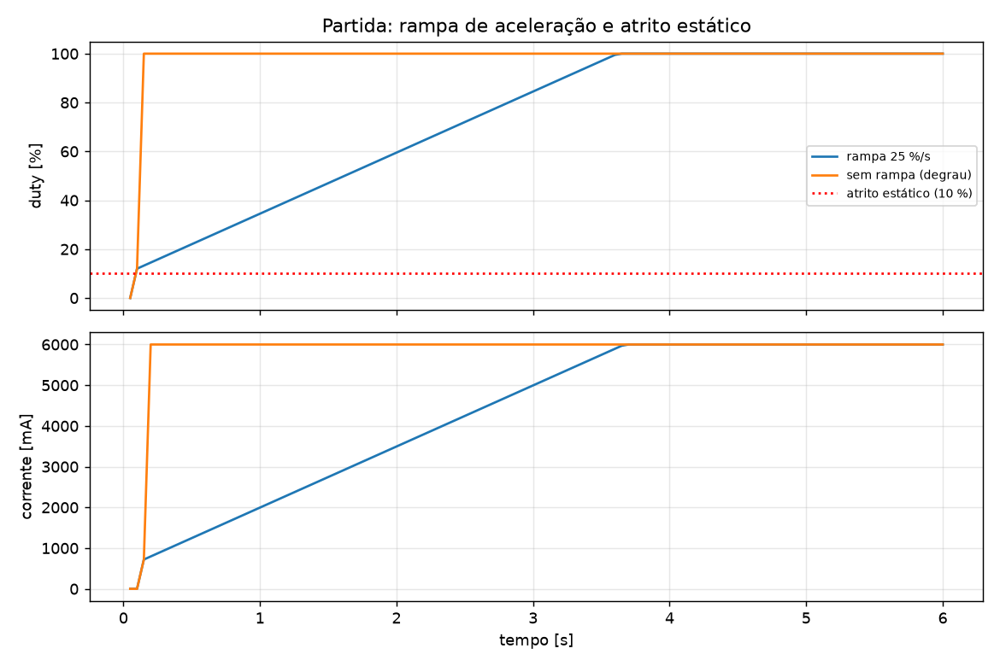
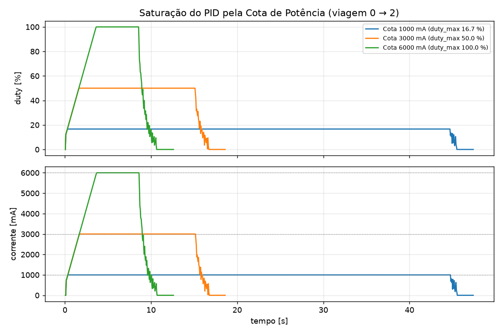
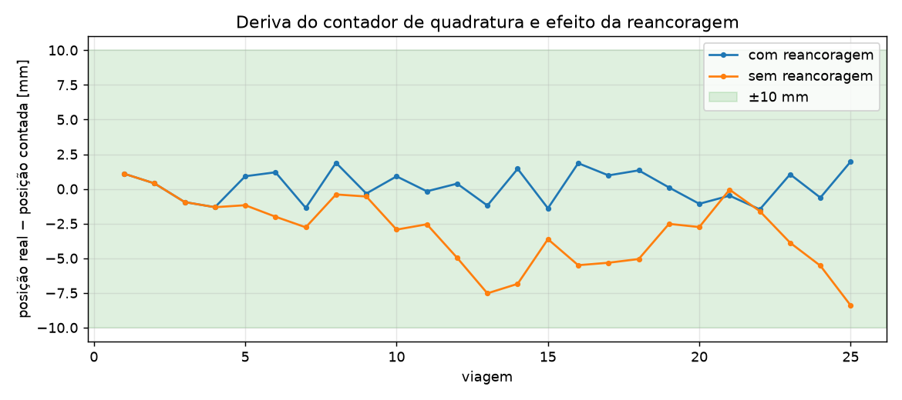

# Entrega Final — Controle de Grupo de Elevadores com Despacho por Destino

Sistema distribuído para 6 andares e 3 cabines (FSE 2026/2 — FGA/UnB): **1 Servidor Central + 3 Servidores
Distribuídos**, quatro processos independentes que cooperam por TCP/IP. Evolui os módulos de GPIO
(`entrega1/`) e UART/MODBUS (`entrega2/`), que **não foram alterados**; o código desta entrega é autossuficiente.

## 1. Arquitetura

```
                       ┌──────────────── Servidor Central (1 processo) ───────────────┐
  BMP280 (I2C 0x76) ──►│ ambiente ─┐                                                  │
                       │           ├─► GerenteModbus (única thread dona da UART,      │──► /dev/serial0
  dashboard/ESP32 ◄────│ despacho ─┤    fila com prioridades) ──────────────────────  │    MODBUS RTU
  (fila 0x20)          │ potência ─┘                                                  │
                       │ rede TCP ◄── persistência (estado.json + viagens.jsonl) ─────┤
                       │ painel/terminal                                              │
                       └──────┬───────────────┬───────────────┬───────────────────────┘
                     TCP/JSON │               │               │   (linhas JSON, porta 5000)
                       ┌──────▼─────┐  ┌──────▼─────┐  ┌──────▼─────┐
                       │ Cabine 1   │  │ Cabine 2   │  │ Cabine 3   │  Servidores Distribuídos
                       │ GPIO (7 pinos): PWM/DIR, encoder A/B, cortina, sensor de andar
                       └────────────┘  └────────────┘  └────────────┘
```

**Exclusividade de periféricos.** Só o Central abre a UART e o I2C; cada Distribuído só toca nos 7 GPIO da sua
cabine. Como `andar_atual`, `porta_estado`, `corrente_ma` e `porta_comando` existem apenas no MODBUS, o TCP carrega
um **espelho MODBUS**: o Central faz o polling das 3 cabines (5 Hz) e **empurra** o estado a cada Distribuído
(`modbus`); os comandos de porta fazem o caminho inverso (`porta_cmd`) e entram na fila prioritária da UART.

### Estrutura do código

| Pacote | Conteúdo |
|:--|:--|
| `elevador/constantes.py` | geometria, limites elétricos, mapas de registradores, `duty_max_da_cota` |
| `elevador/modbus/` | CRC-16, UART serial, cliente `0x03`/`0x10` (matrícula, retentativas), `GerenteModbus` (fila prioritária) |
| `elevador/protocolo/` | mensagens TCP validadas (tipo/faixa/campos), canal JSON-linhas, leitor com buffer |
| `elevador/dominio/` | `Agenda` de paradas e `estimativa` por simulação (puros, compartilhados) |
| `elevador/cabine/` | HAL GPIO (RPi/virtual), encoder, PID, movimento, calibração, Cota, runtime, rede, app |
| `elevador/central/` | servidor TCP, repartição de potência, Despacho, BMP280, persistência, painel, serviço, app |
| `elevador/sim/` | **bancada virtual**: física, MODBUS do "ESP32", servidor TCP, harness e grupo em tempo virtual |
| `config/` | `cabine1..3.json` (pinos BCM da Tabela 1, endereço MODBUS, TCP, PID), `central.json` |
| `scripts/` | `run_all_mock.py`, `gerar_graficos_pid.py` |

## 2. Instalação

```bash
cd entrega_final
python -m venv .venv && source .venv/bin/activate      # Windows: .venv\Scripts\Activate.ps1
pip install -r requirements.txt                          # Python >= 3.11
```

Na Raspberry Pi: habilite a UART (`raspi-config` → Serial: login shell **não**, hardware **sim**) e o I2C. No
Pi 5/Bookworm, troque `RPi.GPIO` por `rpi-lgpio` (mesma API). Nada é instalado/aberto fora do que é listado em
`requirements.txt`.

## 3. Execução

### Bancada virtual (`--mock`, sem Raspberry Pi/ESP32)

```bash
make run-all-mock               # ou: python scripts/run_all_mock.py [--cenario 1|2|3] [--atraso 120] [--temp 35]
```

Sobe a bancada (física dos 6 andares com atrito estático de 10 %, bandeirolas de larguras diferentes, derating,
BMP280 virtual, registradores `0x11`–`0x13` e `0x20`), o Central e as 3 cabines como processos separados;
`Ctrl+C` encerra tudo com parada segura. Para ver o **painel do Central** e digitar comandos, rode cada processo
num terminal:

```bash
python -m elevador.sim                                              # terminal 1 (aceita: chamada 0 3 | cenario 1 | cortina 1 1)
python -m elevador.central --config config/central.json --mock      # terminal 2 (painel + comandos)
python -m elevador.cabine  --config config/cabine1.json --mock      # terminais 3, 4, 5 (cabine2, cabine3)
```

A ordem de partida é livre: cabines e Central se reconectam sozinhos (backoff de 0,25 a 2 s). A calibração leva
≈ 100 s em tempo real (varreduras de subida e descida de ~15 m).

### Hardware

```bash
python -m elevador.central --config config/central.json            # UART /dev/serial0 + BMP280
python -m elevador.cabine  --config config/cabine1.json             # idem cabine2.json, cabine3.json
```

Para rodar as 3 cabines em Raspberries distintas, ajuste `central.host` nos `cabineN.json` e `escuta.host` no
`central.json` (padrão `127.0.0.1`; use o token compartilhado `token` fora do loopback).

### Interface de terminal do Central

Painel (1 Hz, sem bloquear a malha): estado das 3 cabines (andar, posição, sentido, porta, corrente, **Cota
vigente**, modo normal/degradado/calibrando), `barramento_max_ma`, `watchdog_ambiente`, temperatura/pressão,
métricas do cenário (`cenario_ativo`, geradas, atendidas, espera/viagem médias), chamadas pendentes e em atendimento.
Comandos: `ir <cabine 1-3> <andar 0-5>`, `recalibrar <cabine>`, `diag`, `ajuda`, `sair`.

## 4. Protocolo TCP (Central ⇄ Distribuídos)

JSON em UTF-8, **uma mensagem por linha**, máx. 64 KiB, versão `v:1`. O Central escuta; as cabines conectam e
enviam `hello` (inclui a agenda corrente, para reconciliação). Todo campo é validado por tipo, faixa e conjunto
permitido (`elevador/protocolo/mensagens.py`); mensagens inválidas são descartadas sem derrubar a sessão.

| Direção | `t` | Campos principais |
|:--|:--|:--|
| cabine → central | `hello` | `cabine`, `token`, `calibrada`, `agenda`, `andares_mm` |
| | `telemetria` (500 ms) | posição (mm/pulsos), `andar`, `sentido`, `porta`, `corrente_ma`, `estado`, `degradado`, `cota_ma`, `necessidade` |
| | `evento` | `tarefa`, `tipo` (`embarque`/`desembarque`/`manual`), `andar`, `ts` |
| | `porta_cmd`, `pedir_modbus` | comando de porta (1 abrir / 2 fechar); leitura imediata dos registradores |
| central → cabine | `cota` (1 s) | `cota_ma`, `validade_s` = 2 |
| | `modbus` (5 Hz) | `andar_atual`, `nivelado`, `porta_estado`, `corrente_ma`, `falha`, `ts` |
| | `tarefa`, `ir_andar`, `recalibrar` | viagem atribuída pelo Despacho / comando manual / nova calibração |

**Resiliência:** cabines reconectam sozinhas; o Central substitui a sessão antiga se a cabine reinicia; eventos
não enviados ficam numa fila de saída; no `hello` o Central reenvia as tarefas que a cabine perdeu
(`Despachante.reconciliar`). Envio é assíncrono (thread escritora), logo um Central lento nunca atrasa a malha de 50 ms.

## 5. Servidor Distribuído

* **HAL GPIO** (`cabine/hal`): `DIR1/DIR2` livre/subir/descer/freio; PWM a 1 kHz; encoder **por interrupção em A e B**
  (`DecodificadorQuadratura`, 4×, `int32` com sinal, negativo no poço); cortina por interrupção com *debounce* de 40 ms
  (`DebounceCortina`, por temporizador, sem polling); Sensor de Andar por interrupção nas **duas bordas**.
* **Calibração** (`cabine/calibracao.py`), antes de aceitar viagens: descida até a base do poço → varredura completa de
  **subida** → varredura completa de **descida**; em cada bandeirola registra a contagem na borda de entrada e saída; o
  centro é a média das bordas, depois a média dos dois sentidos. O registrador `andar_atual` só **identifica** a
  bandeirola (leitura exigida *posterior* à borda). `nivelado` **não** é consultado (há teste automático por AST).
  Ao fim o andar 0 vira a origem (poço negativo) e o limite de segurança fica em ±380 mm além dos andares extremos.
* **Reancoragem contínua:** a cada borda de entrada a contagem é corrigida para `centro ∓ largura/2`; a cada passagem
  completa (largura coerente com a calibrada) é corrigida para o centro. O PID é compensado sem pico derivativo.
* **PID de 50 ms** (`pid.py`, `movimento.py`): forma por amostra normalizada ao período nominal (jitter não muda o
  ganho), anti-windup por integração condicional + limite da contribuição integral (15 pontos), rampa de aceleração
  (25 %/s) cujo primeiro degrau (12 %) já vence o atrito estático, pulso de arranque para erros pequenos, saturação
  pela Cota e **freio** ao entrar em ±4 mm. A porta só abre com a cabine parada e a **±10 mm** do andar (intertravamento).
* **Cota e Modo Degradado** (`cota.py`): `duty_max = cota_ma/6000·100`; validade de 2 s contados no recebimento;
  expirou ou o TCP caiu ⇒ degradado: 1000 mA (16,67 %), segue até o **próximo andar no sentido atual**, nivela, abre a
  porta e fica parada de porta aberta até receber Cota válida (a abertura é pedida ao Central; se o TCP está caído o
  pedido é reenviado quando a conexão volta — limitação inerente à regra de que só o Central acessa a UART).
* **Porta:** abre → aguarda embarque/desembarque (4 s, `CORTINA` obstruída inibe o fechamento) → fecha → só parte após
  `porta_estado == 0`. Obstrução durante o fechamento manda reabrir e retoma quando liberar (folga de 0,5 s).
* **Telemetria** a cada 500 ms; **SIGINT/SIGTERM**: PWM 0 %, `DIR1=DIR2=1` (freio), libera GPIO e socket.

## 6. Servidor Central

* **BMP280** (`bmp280.py`): driver `smbus2` com compensação de Bosch (testada com o exemplo do datasheet: 25,08 °C /
  1006,53 hPa) + simulador. Escreve offsets 5 e 6 de `0x20` (`0x10`) a cada **2,5 s** (≤ 5 s). Se o I2C falhar por
  mais de 20 s o dado velho **não** é reenviado e o watchdog do simulador (30 s) leva o barramento ao piso de 3000 mA
  (falha segura).
* **Potência** (`potencia.py`): lê `barramento_max_ma` e `watchdog_ambiente` (junto com a fila, 4 Hz) e reparte em
  Cotas: ociosas = 0, que precisam partir = 1000 mA (mínimo), o resto para quem está em movimento, `≤ 6000 mA`,
  **soma ≤ barramento** (verificado exaustivamente nos testes). Renovadas a cada 1 s e **imediatamente** quando uma
  cabine passa a precisar de potência (≥ 100 ms entre renegociações).
* **Despacho por Destino** (`despacho.py`): ver §7.
* **Persistência** (`persistencia.py`): `dados/estado.json` (escrita atômica, a cada 2 s, a cada embarque/desembarque e
  **antes** do `chamada_pop`) com chamadas em andamento, posições calibradas e contadores, restaurado ao iniciar;
  `dados/viagens.jsonl` (append + fsync) com `id_chamada, origem, destino, cabine_atribuida, timestamp_registro,
  timestamp_embarque, timestamp_desembarque` (embarque/desembarque = instante em que a porta abre na origem/destino).
* **Serialização da UART:** `GerenteModbus` — única thread dona da serial, `PriorityQueue` (porta > fila/atribuição >
  polling de cabines > ambiente). MODBUS: 115200 8N1, timeout 0,3 s, 3 tentativas só para timeout/CRC, exceções
  `0x01/0x02/0x03` não se repetem; **matrícula (6 bytes crus) antes do CRC** em toda requisição (config `matricula`).

## 7. Estratégia de Despacho

Cada chamada vai a **exatamente uma** cabine (atribuição definitiva): `0x10` em `atribuicao_chamada_id`/`atribuicao_cabine`
(offsets 9/10), `1` em `chamada_pop` (offset 4) e `tarefa` por TCP. A cabine é escolhida por **simulação**: a agenda de cada
candidata é simulada com e sem a nova viagem (`dominio/estimativa.py`) e vence o menor custo

`custo = W + 0,3·V + 0,7·D + 2·N + 4·max(0, W−35) + 6·max(0, D−40)` (+120 se a cabine está em modo degradado)

com `W` espera estimada até a porta abrir na origem, `V` tempo de viagem, `D` atraso causado a quem já está atribuído e
`N` tarefas pendentes. Paradas coincidentes são contadas uma vez, o que **agrupa destinos coincidentes**; cabines
desconectadas, não calibradas ou em falha são excluídas. A agenda de cada cabine usa varredura direcional (SCAN), insere
paradas intermediárias em voo e **promove embarques com mais de 30 s de espera** (anti-inanição; limite: 90 s).
Passageiros só embarcam se a chamada chegou **antes** do pedido de abertura da porta (senão a cabine reabre).

**Estacionamento por cenário:** cabines ociosas se posicionam conforme `cenario_ativo` — up-peak no térreo, down-peak nos
andares altos, interfloor distribuídas — com paradas "suaves" que cedem a qualquer viagem real.

Resultados na bancada virtual (5 min por cenário, intervalo médio de 8 s entre chamadas; `tests/test_grupo_cenarios.py`):

| Cenário | geradas/atendidas | espera média | espera máx. | violações |
|:--|:-:|:-:|:-:|:-:|
| Up-peak | 43–46 / 100 % | 12–20 s | ≤ 73 s | 0 |
| Down-peak | 32–48 / 100 % | 17–19 s | ≤ 58 s | 0 |
| Interfloor | 31–36 / 100 % | 13–23 s | ≤ 61 s | 0 |

Com o **dobro da carga** (intervalo de 5 s) a espera máxima fica em 55–65 s. Sem violações de porta fora do nível, porta
aberta em movimento, soma de cotas acima do barramento ou chamada perdida.

## 8. Sintonia do PID (experimentos)

Reproduzíveis com `make graficos` (usa o mesmo runtime das cabines em tempo virtual contra a bancada). Planta virtual:
velocidade ≈ 8 mm/s por 1 % de duty, lag de 120 ms, atrito estático de 10 %, bandeirolas de 100–280 mm.



**Conclusão.** Os valores sugeridos (Kp 0,5 / Ki 0,05 / Kd 40) são mantidos como **padrão do código**
(`ParametrosPid`), mas, nesta planta, o termo derivativo por amostra domina e a cabine leva ~38 s por andar, com *chattering*
perto do alvo. Reduzindo Kd para 5 e Ki para 0,02 (**Kp 0,5 / Ki 0,02 / Kd 5**, adotado nos `config/cabine*.json`) o andar
é percorrido em ~9,6 s sem sobre-passo. Kp = 1,0 é ligeiramente mais rápido (8,9 s); mantive 0,5 por ser o valor sugerido e dar mais
margem ao freio final. Como os parâmetros do firmware real podem diferir, **Kp, Ki, Kd, limite integral e rampa são configuráveis** por
cabine em `pid` no JSON — é o ponto de partida para ajustar na bancada física.

| | |
|:--|:--|
|  | Erro **real** de nivelamento em 30 viagens aleatórias: sempre dentro de ±10 mm. |
|  | Rampa de 25 %/s (primeiro degrau de 12 %, acima dos 10 % de atrito) versus degrau: a rampa limita o pico de corrente na partida. |
|  | Saturação pela Cota: duty e corrente nunca passam de `cota/6000`; com 1000 mA a viagem é lenta, mas completa. |
|  | Deriva (real − contada) com e sem reancoragem: sem ela a deriva cresce; com ela fica em ±2 mm. |

## 9. Testes e qualidade

```bash
make test        # pytest -v  (todos passam)
make lint        # ruff check
```

Cobertura: calibração por bordas e reancoragem; quadratura/debounce; PID (anti-windup, rampa, saturação, atrito);
Modo Degradado em voo e parado, e por queda de TCP; cortina; derating térmico e watchdog; BMP280; MODBUS (endianness,
matrícula, retentativas, exceções); repartição de Cotas (invariantes em todas as combinações); Despacho; persistência e
log; protocolo TCP, reconexão e substituição de sessão; Central real contra a bancada; cenários completos; **SIGINT**
real nos processos. A calibração leva ~1 s de CPU nos testes porque o runtime roda em tempo virtual
(`elevador/sim/harness.py` e `grupo.py`).

## 10. Premissas e limitações

* O firmware real do simulador não foi acessível: a bancada virtual reproduz o protocolo validado na Entrega 2 e um modelo
  físico simples (parâmetros em `sim/fisica.py`). Constantes de tempo do Despacho (`tempos` em `central.json`) devem ser
  recalibradas com medições reais.
* O instante de "registro" no log é o da leitura da fila pelo Central (o simulador não expõe o seu).
* Se o TCP estiver caído, a cabine entra em modo degradado e pousa, mas só consegue **abrir a porta** quando a conexão
  voltar (somente o Central acessa a UART).
* Sem hardware nesta máquina, `RPi.GPIO`, `smbus2` e a UART serial **não** foram exercitados fisicamente; os caminhos de
  hardware seguem a mesma interface (`GpioCabine`, `UartBase`, `SensorAmbiente`) usada pelos testes.
