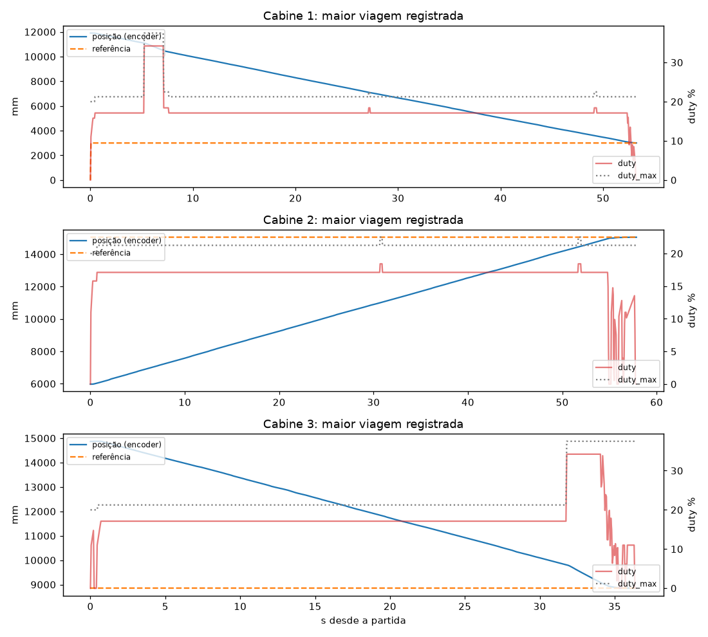
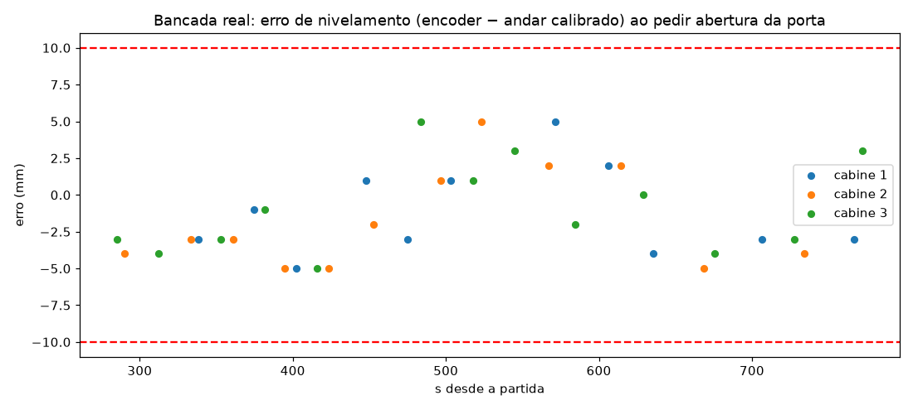
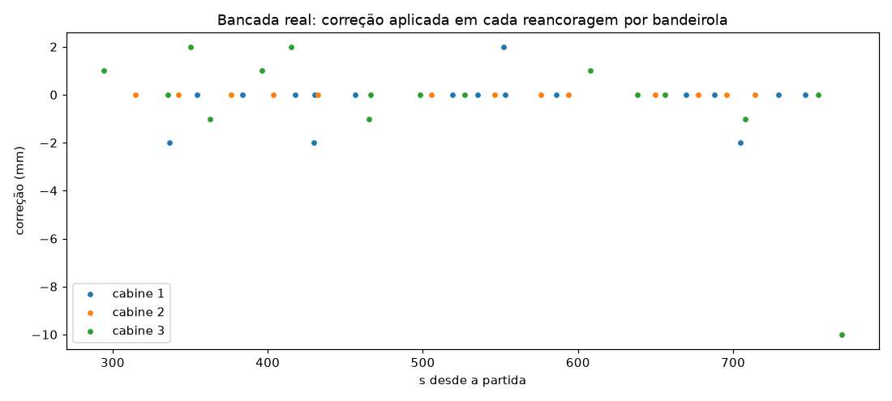
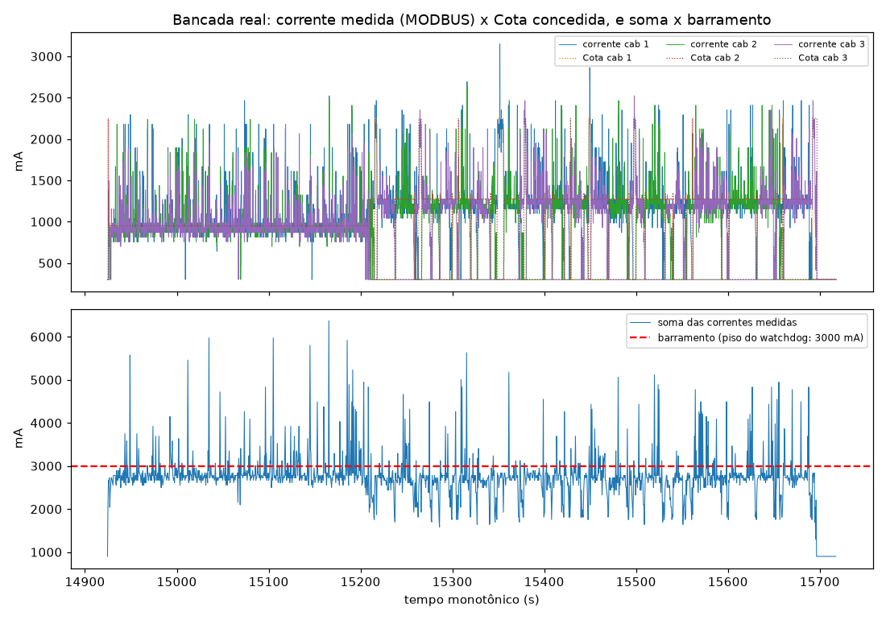

# Entrega Final — Controle de Grupo de Elevadores com Despacho por Destino

*Vídeo de apresentação*: https://youtu.be/qjND2SU4JKI

Sistema distribuído para 6 andares e 3 cabines (FSE 2026/2 — FGA/UnB): **1 Servidor Central + 3 Servidores
Distribuídos**, quatro processos independentes que cooperam por TCP/IP. Evolui os módulos de GPIO
(`entrega1/`) e UART/MODBUS (`entrega2/`), que **não foram alterados**; o código desta entrega é autossuficiente.

## 1. Arquitetura

```
                       ┌──────────────── Servidor Central (1 processo) ───────────────┐
  BMP280 (I2C 0x76) ──►│ ambiente ─┐                                                  │
                       │           ├─► GerenteModbus (única thread dona da UART,      │──► /dev/serial0
  dashboard/ESP32 ◄────│ despacho ─┤    fila com prioridades) ──────────────────────  │    MODBUS RTU
  (fila 0x20)          │ potência ─┘                                                  │
                       │ rede TCP ◄── persistência (estado.json + viagens.jsonl) ─────┤
                       │ painel/terminal                                              │
                       └──────┬───────────────┬───────────────┬───────────────────────┘
                     TCP/JSON │               │               │   (linhas JSON, porta 5000)
                       ┌──────▼─────┐  ┌──────▼─────┐  ┌──────▼─────┐
                       │ Cabine 1   │  │ Cabine 2   │  │ Cabine 3   │  Servidores Distribuídos
                       │ GPIO (7 pinos): PWM/DIR, encoder A/B, cortina, sensor de andar
                       └────────────┘  └────────────┘  └────────────┘
```

**Exclusividade de periféricos.** Só o Central abre a UART e o I2C; cada Distribuído só toca nos 7 GPIO da sua
cabine. Como `andar_atual`, `porta_estado`, `corrente_ma` e `porta_comando` existem apenas no MODBUS, o TCP carrega
um **espelho MODBUS**: o Central faz o polling das 3 cabines (5 Hz) e **empurra** o estado a cada Distribuído
(`modbus`); os comandos de porta fazem o caminho inverso (`porta_cmd`) e entram na fila prioritária da UART.

### Estrutura do código

| Pacote | Conteúdo |
|:--|:--|
| `elevador/constantes.py` | geometria, limites elétricos, mapas de registradores, `duty_max_da_cota` |
| `elevador/modbus/` | CRC-16, UART serial, cliente `0x03`/`0x10` (matrícula, retentativas), `GerenteModbus` (fila prioritária) |
| `elevador/protocolo/` | mensagens TCP validadas (tipo/faixa/campos), canal JSON-linhas, leitor com buffer |
| `elevador/dominio/` | `Agenda` de paradas e `estimativa` por simulação (puros, compartilhados) |
| `elevador/cabine/` | HAL GPIO (RPi/virtual), encoder, PID, movimento, calibração, Cota, runtime, rede, app |
| `elevador/central/` | servidor TCP, repartição de potência, Despacho, BMP280, persistência, painel, serviço, app |
| `elevador/sim/` | **bancada virtual**: física, MODBUS do "ESP32", servidor TCP, harness e grupo em tempo virtual |
| `config/` | `cabine1..3.json` (pinos BCM da Tabela 1, endereço MODBUS, TCP, PID), `central.json` |
| `scripts/` | `run_all_mock.py`, `gerar_graficos_pid.py` |

## 2. Instalação

```bash
cd entrega_final
python -m venv .venv && source .venv/bin/activate      # Windows: .venv\Scripts\Activate.ps1
pip install -r requirements.txt                          # Python >= 3.11
```

Na Raspberry Pi: habilite a UART (`raspi-config` → Serial: login shell **não**, hardware **sim**) e o I2C. No
Pi 5/Bookworm, troque `RPi.GPIO` por `rpi-lgpio` (mesma API). Nada é instalado/aberto fora do que é listado em
`requirements.txt`.

## 3. Execução

### Bancada virtual (`--mock`, sem Raspberry Pi/ESP32)

```bash
make run-all-mock               # ou: python scripts/run_all_mock.py [--cenario 1|2|3] [--atraso 120] [--temp 35]
```

Sobe a bancada (física dos 6 andares com atrito estático de 10 %, bandeirolas de larguras diferentes, derating,
BMP280 virtual, registradores `0x11`–`0x13` e `0x20`), o Central e as 3 cabines como processos separados;
`Ctrl+C` encerra tudo com parada segura. Para ver o **painel do Central** e digitar comandos, rode cada processo
num terminal:

```bash
python -m elevador.sim                                              # terminal 1 (aceita: chamada 0 3 | cenario 1 | cortina 1 1)
python -m elevador.central --config config/central.json --mock      # terminal 2 (painel + comandos)
python -m elevador.cabine  --config config/cabine1.json --mock      # terminais 3, 4, 5 (cabine2, cabine3)
```

A ordem de partida é livre: cabines e Central se reconectam sozinhos (backoff de 0,25 a 2 s). A calibração leva
≈ 100 s em tempo real (varreduras de subida e descida de ~15 m).

### Hardware

Opcional nos Distribuídos: `--registro-csv dados/hw/malha_cabN.csv` grava a malha a cada tick (t, estado, posição,
alvo, erro, duty, Cota, modo, reancoragens, correção, corrente) e `--log-arquivo` envia o log para arquivo; com eles
`python scripts/graficos_bancada.py dados/hw docs/graficos` gera os gráficos 06–09 da §8.1.

```bash
python -m elevador.central --config config/central.json            # UART /dev/serial0 + BMP280
python -m elevador.cabine  --config config/cabine1.json             # idem cabine2.json, cabine3.json
```

Para rodar as 3 cabines em Raspberries distintas, ajuste `central.host` nos `cabineN.json` e `escuta.host` no
`central.json` (padrão `127.0.0.1`; use o token compartilhado `token` fora do loopback).

### Interface de terminal do Central

Painel (1 Hz, sem bloquear a malha): estado das 3 cabines (andar, posição, sentido, porta, corrente, **Cota
vigente**, modo normal/degradado/calibrando), `barramento_max_ma`, `watchdog_ambiente`, temperatura/pressão,
métricas do cenário (`cenario_ativo`, geradas, atendidas, espera/viagem médias), chamadas pendentes e em atendimento.
Comandos: `ir <cabine 1-3> <andar 0-5>`, `recalibrar <cabine>`, `cotas off|on`, `diag`, `ajuda`, `sair`.

`cotas off` suspende a renovação das Cotas com o Central **vivo** (Teste 1 do Modo Degradado): em até 2 s as cabines
expiram a Cota, desaceleram para 1000 mA, pousam no próximo andar no sentido do movimento e abrem a porta — a
abertura funciona porque o Central continua dono da UART. `cotas on` retoma a operação normal.

## 4. Protocolo TCP (Central ⇄ Distribuídos)

JSON em UTF-8, **uma mensagem por linha**, máx. 64 KiB, versão `v:1`. O Central escuta; as cabines conectam e
enviam `hello` (inclui a agenda corrente, para reconciliação). Todo campo é validado por tipo, faixa e conjunto
permitido (`elevador/protocolo/mensagens.py`); mensagens inválidas são descartadas sem derrubar a sessão.

| Direção | `t` | Campos principais |
|:--|:--|:--|
| cabine → central | `hello` | `cabine`, `token`, `calibrada`, `agenda`, `andares_mm` |
| | `telemetria` (500 ms) | posição (mm/pulsos), `andar`, `sentido`, `porta`, `corrente_ma`, `estado`, `degradado`, `cota_ma`, `necessidade` |
| | `evento` | `tarefa`, `tipo` (`embarque`/`desembarque`/`manual`), `andar`, `ts` |
| | `porta_cmd`, `pedir_modbus` | comando de porta (1 abrir / 2 fechar); leitura imediata dos registradores |
| central → cabine | `cota` (1 s) | `cota_ma`, `validade_s` = 2 |
| | `modbus` (5 Hz) | `andar_atual`, `porta_estado`, `corrente_ma`, `falha`, `ts` (sem `nivelado` nem `posicao_mm`) |
| | `tarefa`, `ir_andar`, `recalibrar` | viagem atribuída pelo Despacho / comando manual / nova calibração |
| | `porta_recusada` | intertravamento: o simulador não viu a cabine nivelada e o ABRIR não foi enviado |

**Resiliência:** cabines reconectam sozinhas; o Central substitui a sessão antiga se a cabine reinicia; eventos
não enviados ficam numa fila de saída; no `hello` o Central reenvia as tarefas que a cabine perdeu
(`Despachante.reconciliar`). Envio é assíncrono (thread escritora), logo um Central lento nunca atrasa a malha de 50 ms.

## 5. Servidor Distribuído

* **HAL GPIO** (`cabine/hal`): `DIR1/DIR2` livre/subir/descer/freio; PWM a 1 kHz; encoder **por interrupção em A e B**
  (`DecodificadorQuadratura`, 4×, `int32` com sinal, negativo no poço); cortina por interrupção com *debounce* de 40 ms
  (`DebounceCortina`, por temporizador, sem polling); Sensor de Andar por interrupção nas **duas bordas**.
* **Calibração** (`cabine/calibracao.py`), antes de aceitar viagens: descida até a base do poço → varredura completa de
  **subida** → varredura completa de **descida**; em cada bandeirola registra a contagem na borda de entrada e saída; o
  centro é a média das bordas, depois a média dos dois sentidos. O registrador `andar_atual` só **identifica** a
  bandeirola (leitura exigida *posterior* à borda). `nivelado` **não** é consultado (há teste automático por AST).
  Ao fim o andar 0 vira a origem (poço negativo) e o limite de segurança fica em ±380 mm além dos andares extremos.
* **Reancoragem contínua:** a cada borda de entrada a contagem é corrigida para `centro ∓ largura/2`; a cada passagem
  completa (largura coerente com a calibrada) é corrigida para o centro. O PID é compensado sem pico derivativo.
* **PID de 50 ms** (`pid.py`, `movimento.py`): forma por amostra normalizada ao período nominal (jitter não muda o
  ganho), anti-windup por integração condicional + limite da contribuição integral (15 pontos), rampa de aceleração
  (25 %/s) cujo primeiro degrau (11 %) já vence o atrito estático, pulso de arranque para erros pequenos e saturação
  pela Cota. **Parada preditiva** (ajustada com os CSVs da rasp32): o freio entra quando o ponto de parada previsto
  `erro − v·60 ms` fica a ≤ 2,5 mm do alvo, e a chegada só é aceita a **≤ 5 mm** (metade da tolerância); acima disso há
  nova aproximação fina. A margem absorve o erro residual entre encoder e andar real — com aceite em 10 mm a cabine 3
  parou na borda e o simulador recusou a porta.
* **Cota e Modo Degradado** (`cota.py`, `constantes.py`): `duty_max = min(cota/6000·100, (cota − 300)/57)` — o teto do
  enunciado restringido pelo **modelo de corrente medido no firmware** (`I = 300 mA de repouso + 57 mA por ponto de
  duty`, ver §8.1); validade de 2 s contados no recebimento; expirou ou o TCP caiu ⇒ degradado: 1000 mA (12,3 % de
  duty, acima dos 10 % do atrito), segue até o **próximo andar no sentido atual**, nivela, abre a porta e **mantém a
  porta aberta** até receber Cota válida (o firmware fecha a porta sozinho 3 s após abrir; a cabine re-comanda ABRIR).
  Se o TCP está caído o pedido de porta só sai quando a conexão volta (só o Central acessa a UART).
* **Recentralização da porta:** se o Central recusar o ABRIR (intertravamento) ou o simulador ignorar ~3 pedidos, a
  cabine refaz a aproximação com aceite de ±2 mm e pede de novo.
* **Porta:** abre → aguarda embarque/desembarque (4 s, `CORTINA` obstruída inibe o fechamento) → fecha → só parte após
  `porta_estado == 0`. Obstrução durante o fechamento manda reabrir e retoma quando liberar (folga de 0,5 s).
* **Telemetria** a cada 500 ms; **SIGINT/SIGTERM**: PWM 0 %, `DIR1=DIR2=1` (freio), libera GPIO e socket.

## 6. Servidor Central

* **BMP280** (`bmp280.py`): driver `smbus2` com compensação de Bosch (testada com o exemplo do datasheet: 25,08 °C /
  1006,53 hPa) + simulador. Escreve offsets 5 e 6 de `0x20` (`0x10`) a cada **2,5 s** (≤ 5 s). Se o I2C falhar por
  mais de 20 s o dado velho **não** é reenviado e o watchdog do simulador (30 s) leva o barramento ao piso de 3000 mA
  (falha segura). O driver **nunca inventa leitura**: com o sensor ausente o Central sobe mesmo assim, registra o erro
  e tenta reidentificar o chip (`0xD0`) a cada ciclo.
* **Potência** (`potencia.py`): lê `barramento_max_ma` e `watchdog_ambiente` (junto com a fila, 4 Hz) e reparte 95 %
  do barramento (margem para o ruído do PWM por software). Toda cabine consome **300 mA de repouso** mesmo parada, então
  a Cota de uma ociosa é 300 (duty 0); quem precisa partir só é **admitido** se couber com ≥ 1200 mA (~16 % de duty),
  senão espera; quem está em movimento nunca perde o piso de 1000 mA; o resto vai para quem se move, `≤ 6000 mA`.
  **Soma das Cotas ≤ barramento e soma das correntes previstas pelo modelo ≤ barramento** (verificado em todas as
  combinações nos testes). Renovadas a cada 1 s e **imediatamente** quando a demanda muda, em **break-before-make**:
  as reduções saem primeiro e as concessões 300 ms depois. Uma cabine que **cai do TCP em movimento** pousa sozinha em
  Modo Degradado com até 1000 mA; o Central **reserva** essa corrente por até 60 s (ou até a cabine voltar).
* **Intertravamento da porta** (defesa em profundidade): a cabine decide parar pelo encoder, mas o Central só
  repassa um ABRIR depois de ler a cabine e ver `nivelado = 1`; senão responde `porta_recusada`. Assim nenhum comando
  de porta fora do nível chega ao simulador (a falha 0x01 do firmware). O registrador `nivelado` **nunca** entra na
  calibração nem na malha de controle.
* **Auditoria:** cada mudança de `porta_estado`, `falha` ou `passageiros` vai para o log com `nivelado`, `andar_atual`,
  `posicao_mm`, corrente e carga lidos do simulador (evidência dos experimentos da §8.1).
* **Despacho por Destino** (`despacho.py`): ver §7.
* **Persistência** (`persistencia.py`): `dados/estado.json` (escrita atômica, a cada 2 s, a cada embarque/desembarque e
  **antes** do `chamada_pop`) com chamadas em andamento, posições calibradas e contadores, restaurado ao iniciar;
  `dados/viagens.jsonl` (append + fsync) com `id_chamada, origem, destino, cabine_atribuida, timestamp_registro,
  timestamp_embarque, timestamp_desembarque` (embarque/desembarque = instante em que a porta abre na origem/destino).
* **Serialização da UART:** `GerenteModbus` — única thread dona da serial, `PriorityQueue` (porta > fila/atribuição >
  polling de cabines > ambiente). MODBUS: 115200 8N1, timeout 0,3 s, 3 tentativas só para timeout/CRC, exceções
  `0x01/0x02/0x03` não se repetem; **matrícula (6 bytes crus) antes do CRC** em toda requisição (config `matricula`).
  O CRC é o `crc16.c` da disciplina (polinômio 0xA001, **valor inicial 0x0000**, CRC-16/ARC) — não o CRC-16/MODBUS
  padrão (init 0xFFFF), que o simulador rejeita; os quadros literais do enunciado são conferidos byte a byte nos testes.
  Uma `SerialException` fecha e reabre a porta na tentativa seguinte.

## 7. Estratégia de Despacho

Cada chamada vai a **exatamente uma** cabine (atribuição definitiva): `0x10` em `atribuicao_chamada_id`/`atribuicao_cabine`
(offsets 9/10), `1` em `chamada_pop` (offset 4) e `tarefa` por TCP. A cabine é escolhida por **simulação**: a agenda de cada
candidata é simulada com e sem a nova viagem (`dominio/estimativa.py`) e vence o menor custo

`custo = W + 0,3·V + 0,7·D + 2·N + 4·max(0, W−35) + 6·max(0, D−40)` (+120 se a cabine está em modo degradado)

com `W` espera estimada até a porta abrir na origem, `V` tempo de viagem, `D` atraso causado a quem já está atribuído e
`N` tarefas pendentes. Paradas coincidentes são contadas uma vez, o que **agrupa destinos coincidentes**; cabines
desconectadas, não calibradas ou em falha são excluídas. A agenda de cada cabine usa varredura direcional (SCAN), insere
paradas intermediárias em voo e **promove embarques com mais de 30 s de espera** (anti-inanição; limite: 90 s).
Passageiros só embarcam se a chamada chegou **antes** do pedido de abertura da porta (senão a cabine reabre).

**Lotação:** o firmware aceita **8 passageiros (600 kg, 75 kg cada — medido)** e liga a falha 0x10 "sobrecarga" se
mais gente embarca. O Despacho simula a ocupação ao longo da agenda de cada candidata e **só atribui se a ocupação
prevista ficar ≤ 8**; se nenhuma cabine couber a chamada permanece na fila `0x20` até haver lugar. A agenda da cabine
também só registra embarques até a lotação (FIFO por registro).

**Estacionamento por cenário:** cabines ociosas se posicionam conforme `cenario_ativo` — up-peak no térreo, down-peak nos
andares altos, interfloor distribuídas — com paradas "suaves" que cedem a qualquer viagem real.

Resultados na bancada virtual (5 min por cenário, intervalo médio de 8 s entre chamadas; `tests/test_grupo_cenarios.py`):

| Cenário | geradas/atendidas | espera média | espera máx. | violações |
|:--|:-:|:-:|:-:|:-:|
| Up-peak | 43–46 / 100 % | 15–16 s | ≤ 47 s | 0 |
| Down-peak | 32–48 / 100 % | 18–19 s | ≤ 61 s | 0 |
| Interfloor | 34–36 / 100 % | 18–22 s | ≤ 61 s | 0 |

Com **carga ~60 % maior** (intervalo de 5 s, 50–73 chamadas) a espera máxima fica em 51–77 s. Sem violações de porta
fora do nível, porta aberta em movimento, sobrecarga do barramento (corrente real), lotação acima de 8 ou chamada
perdida. Bancada virtual a 25 °C (barramento de 12000 mA), com o mesmo modelo de corrente e de lotação do firmware.

## 8. Sintonia do PID (experimentos)

Reproduzíveis com `make graficos` (usa o mesmo runtime das cabines em tempo virtual contra a bancada). Planta virtual:
velocidade ≈ 8 mm/s por 1 % de duty, lag de 120 ms, atrito estático de 10 %, bandeirolas de 100–280 mm.


**Conclusão.** Os valores sugeridos (Kp 0,5 / Ki 0,05 / Kd 40) são mantidos como **padrão do código**
(`ParametrosPid`), mas, nesta planta, o termo derivativo por amostra domina e a cabine leva ~38 s por andar, com *chattering*
perto do alvo. Reduzindo Kd para 5 e Ki para 0,02 (**Kp 0,5 / Ki 0,02 / Kd 5**, adotado nos `config/cabine*.json`) o andar
é percorrido em ~9,6 s sem sobre-passo. Kp = 1,0 é ligeiramente mais rápido (8,9 s); mantive 0,5 por ser o valor sugerido e dar mais
margem ao freio final. Como os parâmetros do firmware real podem diferir, **Kp, Ki, Kd, limite integral e rampa são configuráveis** por
cabine em `pid` no JSON — é o ponto de partida para ajustar na bancada física.

| | |
|:--|:--|
|  | Erro **real** de nivelamento em 30 viagens aleatórias: sempre dentro de ±10 mm. |
|  | Rampa de 25 %/s (primeiro degrau de 12 %, acima dos 10 % de atrito) versus degrau: a rampa limita o pico de corrente na partida. |
|  | Saturação pela Cota: duty e corrente nunca passam de `cota/6000`; com 1000 mA a viagem é lenta, mas completa. |
|  | Deriva (real − contada) com e sem reancoragem: sem ela a deriva cresce; com ela fica em ±2 mm. |

### 8.1 Validação na bancada real (rasp32, 15–16/10/2026)

Raspberry Pi 3 B (Debian 13, Python 3.13, `RPi.GPIO` 0.7.2 = shim `rpi-lgpio`) + ESP32 do laboratório, os 4 processos
na própria Pi (Central e 3 cabines em janelas `tmux`), 7 execuções completas (15–16/10/2026). Gráficos 06–09 e o
resumo vêm da execução 7, já com o código final. Dados brutos em `dados/bancada_real/`
(fora do git); resumo em `docs/graficos/resumo_bancada_real.json`.

| Verificação | Resultado medido |
|:--|:--|
| MODBUS (CRC init 0x0000, matrícula, endianness) | leituras de `0x11`–`0x13` e `0x20` corretas; exceções `0x02` (faixa fora do mapa e escrita em somente-leitura) reconhecidas; 16 ms por transação |
| Calibração por interrupção (subida + descida) | 3–5 min por cabine; posições repetíveis entre execuções (±1 mm nas cabines 2 e 3): cab. 1 `0, 3000, 6000, 8945, 11905, 14860`, cab. 2 `0, 3055, 5980, 9070, 11995, 15050`, cab. 3 `0, 2865, 5935, 8850, 11915, 14870` |
| Nivelamento (encoder × andar calibrado ao pedir a porta) | antes da correção: erro máx. 9–10 mm e uma porta recusada; com a parada preditiva (execuções 4–7): **132 chegadas, máx. 5 mm, média 3,0 mm**; simulador reportou `nivelado = 1` em **todas** as aberturas; 0 recusas do intertravamento |
| Reancoragem | correções de até **24 mm** por bandeirola (a deriva descrita no enunciado); 19–39 reancoragens por cabine por execução |
| Período da malha | média **50,0 ms**, p99 **50–51 ms** (3 cabines + Central na mesma Pi 3) |
| Ciclo de porta | `fechada → abrindo → aberta → fechando → fechada` em todas as paradas; o firmware fecha a porta sozinho 3 s após abrir |
| Teste 1 (Modo Degradado, `cotas off`) | cabine subindo em 4257 mm pousou no **andar 2** (próximo no sentido) em ~17 s, `nivelado = 1`, porta aberta e **mantida aberta** até `cotas on`; depois concluiu a viagem ao andar 5 |
| Despacho com chamadas reais da fila `0x20` | quiosque: 3/3 atendidas (espera 2,4–56,8 s); 1 Interfloor + 2 Up-peak (225 chamadas): **228 viagens únicas** no `viagens.jsonl`, nenhuma duplicada nem perdida pelo Central; ocupação máxima observada **8** (lotação); 0 recusas de porta |
| TCP / persistência | Central reiniciado por SIGINT **com 26 e 49 chamadas em andamento**: estado restaurado e as 3 cabines reconectadas em ~0,4 s, sem perda de função; reinício **de todos** os processos com 30 chamadas em andamento: as cabines recalibraram, receberam 10 tarefas cada por reconciliação e as 47 chamadas restantes (30 + 17 da fila) foram concluídas |
| SIGINT | todos os processos saem com código 0; depois da saída `pinctrl` mostra PWM 13/11/18 = **lo** e DIR 22,23 / 17,27 / 24,25 = **hi (freio)** |
| pytest na Pi | **160/160** com o código final na Raspberry (Python 3.13/aarch64, 498 s); `ruff check` e `ruff format --check` limpos |

**O que os experimentos reais mudaram no código** (tudo coberto por testes de regressão):

1. **CRC** — o HEAD anterior usava init 0xFFFF (CRC-16/MODBUS); o firmware usa o `crc16.c` da disciplina (init 0x0000).
2. **Parada preditiva + aceite de 5 mm** — o aceite em 10 mm deixou a cabine 3 na borda e o simulador recusou a porta.
3. **Intertravamento de porta no Central** e **recentralização** na cabine.
4. **Modelo de corrente** `I = 300 + 57·duty` (gráfico 09): a fórmula `cota/6000` ignorava o repouso e cada cabine
   puxava 1212 mA com Cota de 1000 (3636 mA num barramento de 3000). Com o modelo: 870–927 mA com Cota de 950.
5. **Break-before-make** nas Cotas e **admissão de partidas** (≥ 1200 mA): a 11 % de duty o jitter do PWM por
   software faz o p90 da corrente medida chegar a +27 % da Cota (a 17 %, só +4 %); a vazão total não muda porque a
   velocidade é linear no duty (≈ 9,4 mm/s por ponto, medido).
6. **Porta mantida aberta no degradado** (o firmware fecha sozinho em 3 s) e **lotação de 8** no Despacho.
7. **Livelock de cabine lotada** — com embarques antigos pendentes no próprio andar e a cabine cheia, a regra
   anti-inanição a fazia abrir/fechar a porta sem fim, segurando a Cota de partida (a terceira cabine ficou sem
   potência por ~12 min). Agora, lotada, ela só considera destinos de quem está a bordo, e só pede Cota de partida
   quando está ociosa e pronta para sair.

**Corrente × Cota (gráfico 09, execução 7):** na mediana a corrente medida fica **23–63 mA abaixo da Cota** nas três
cabines, e a soma das três tem linha de base de ~2800 mA no barramento de 3000. Como o controle opera saturado na
própria Cota, o ruído de leitura cai dos dois lados: ~25 % das leituras ficam acima, 54–60 % delas picos de uma única
amostra (até ~2500 mA) causados pelo *jitter* do PWM por software (thread do `lgpio` preemptada estica um pulso e a ESP32
lê duty alto naquela janela) — inclusive na calibração, com duty constante. Operar ~15 % abaixo da Cota cortaria parte
disso, mas no piso de 3000 mA deixaria as cabines abaixo do atrito estático; a margem de 5 % no barramento foi mantida.

| | |
|:--|:--|
|  | Maior viagem de cada cabine na bancada: posição do encoder, referência, duty e `duty_max` da Cota. |
|  | Erro de nivelamento real ao pedir a porta (todas dentro de ±5 mm; faixa vermelha = ±10 mm). |
|  | Correção aplicada a cada passagem por bandeirola: a deriva real do contador por software. |
|  | Corrente medida × Cota e soma das 3 correntes × barramento de 3000 mA (watchdog). |

**Pendência de hardware da rasp32:** o **BMP280 não responde** — nenhum dispositivo em `/dev/i2c-1` nem `/dev/i2c-2`
(varredura completa, Errno 121). O Central sobe mesmo assim, não inventa leitura e o watchdog mantém o barramento no
piso de 3000 mA. Nesse regime (≈ 1/4 da capacidade nominal) a vazão física das 3 cabines é menor que a demanda dos
cenários de 5 min (uma chamada a cada ~4 s): no Up-peak final, 75 geradas, espera média de 71 s e 15 de 28 esperas acima
de 90 s durante o cenário (o simulador fechou a execução com 74/75 atendidas, espera média inflada pelos ~12 min do
livelock da correção 7, ocorrido antes da correção). Isso não é corrigível no software (o enunciado: *sem a cadeia I2C → MODBUS o edifício não se
move*); com o sensor presente o barramento volta a até 12000 mA e os cenários equivalem aos da bancada virtual acima.
Os bits de falha 0x01/0x02 já estavam travados nas cabines antes desta validação; 0x10 (lotação) e 0x20 (espera > 90 s)
foram ligados durante os cenários com o barramento no piso — a falha de lotação motivou a correção 6. Esses bits só
zeram com o reset do simulador.

## 9. Testes e qualidade

```bash
make test        # pytest -v  (todos passam)
make lint        # ruff check
```

Cobertura: calibração por bordas e reancoragem; quadratura/debounce; PID (anti-windup, rampa, saturação, atrito);
Modo Degradado em voo e parado, e por queda de TCP; cortina; derating térmico e watchdog; BMP280; MODBUS (endianness,
matrícula, retentativas, exceções); repartição de Cotas (invariantes em todas as combinações); Despacho; persistência e
log; protocolo TCP, reconexão e substituição de sessão; Central real contra a bancada; cenários completos; **SIGINT**
real nos processos. A calibração leva ~1 s de CPU nos testes porque o runtime roda em tempo virtual
(`elevador/sim/harness.py` e `grupo.py`).

## 10. Premissas e limitações

* A bancada virtual reproduz o protocolo e os comportamentos **medidos** no firmware real (corrente com repouso, falhas
  0x01/0x02, recusa de porta fora do nível, lotação de 8), mas a dinâmica é simplificada (`sim/fisica.py`). As constantes
  de tempo do Despacho (`tempos` em `central.json`) são estimativas.
* O instante de "registro" no log é o da leitura da fila pelo Central (o simulador não expõe o seu).
* Se o TCP estiver caído, a cabine entra em modo degradado e pousa, mas só consegue **abrir a porta** quando a conexão
  voltar (somente o Central acessa a UART).
* Os caminhos de hardware (`RPi.GPIO`/`rpi-lgpio`, UART e I2C) foram exercitados na rasp32 (§8.1), exceto a leitura
  bem-sucedida do BMP280, ausente naquela bancada (o driver foi validado com o exemplo do datasheet e com um
  barramento I2C falso nos testes). Com 3 processos de cabine na mesma pasta, use `LG_WD` distinto por processo:
  o `rpi-lgpio` cria FIFOs `.lgd-nfy*` no diretório de trabalho.
